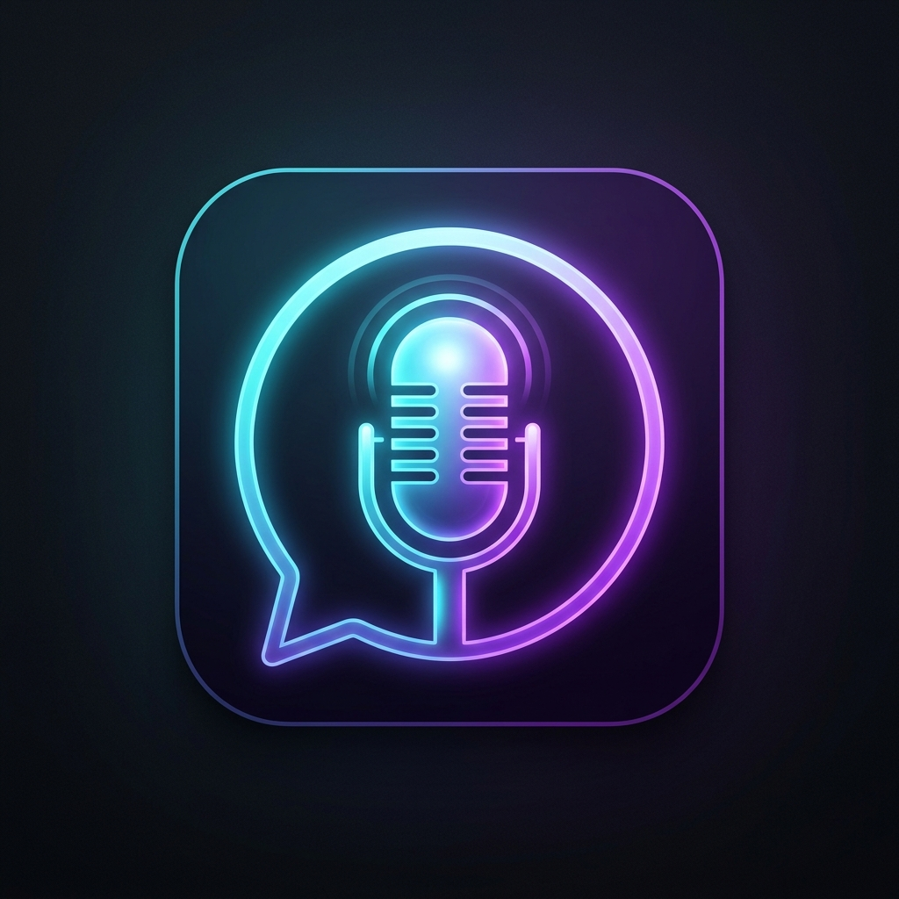

# 🎙 QuickTTS - Floating Bubble Mic TTS Bot (Discord-Only & Gaming Edition)

A modern, sleek, keyboard-driven Text-to-Speech bot that injects high-fidelity AI speech directly into Discord without bleeding into your game, featuring a smart floating text bubble that captures typing automatically.

---

## ✨ Features & What's New

- **🎯 Discord-Only Output Mode**:
  - Route TTS speech **strictly to Discord**.
  - In-game voice chat (e.g., Valorant, CS2, Fortnite, Apex, Call of Duty) will **NEVER** hear the bot speech.
  - Your real voice still works in-game through your physical headset mic!
- **🎮 Seamless In-Game Typing (No Game Movement)**:
  - When you press your hotkey (`Ctrl + Space`), keyboard focus is **instantly transferred** to the text bubble.
  - Typing `W`, `A`, `S`, `D`, `Space`, etc. will **NOT** move, jump, shoot, or trigger abilities in your game.
  - When you hit **`Enter`** (to speak) or **`Esc`** (to cancel), focus is automatically restored back to your game window!
  - Hotkey suppression prevents the trigger key (like `Space`) from bleeding into games.
- **🎧 Real-Time Headphone Monitoring**:
  - Hear yourself speak in your headphones simultaneously so you always know what was said.
- **🤖 300+ Ultra-Realistic Neural Voices**:
  - Microsoft Edge Neural TTS (Natural, human-like voices) with offline fallback.
- **🎛 Full Speech & Volume Control**:
  - Independent volume sliders for your Discord output and headphone monitor, plus pitch and speed adjustments.
- **📜 Message History & Quick Phrases**:
  - Press **Up / Down** arrow keys to recall previous messages.
  - Click `💬` in the bubble to speak common canned phrases.

---

## 🎮 How to Setup "Discord-Only" Mode

Follow these 3 easy steps to make the TTS bot speak **ONLY** in Discord:

### 1. In QuickTTS Settings:
1. Open QuickTTS Settings (`⚙` button in the bubble or right-click the tray icon).
2. Under **Audio Routing**, select **🎯 Discord-Only Output**.
3. Choose your dedicated output device:
   - If using **Voicemeeter**: Select `Voicemeeter AUX Input [Windows WASAPI]`.
   - If using **SteelSeries Sonar**: Select `SteelSeries Sonar - Chat`.
   - If using **Voicemod**: Select `Line Out (Voicemod VAD Wave)`.
   - If using **VB-Cable**: Select `CABLE Input`.
4. Click **Save & Apply**.

### 2. In Discord Settings:
1. Go to **Discord Settings > Voice & Video > Input Device**.
2. Set your **Input Device** to:
   - For Voicemeeter: **Voicemeeter Out B2** (or `Voicemeeter AUX Output`).
   - For SteelSeries Sonar: **SteelSeries Sonar - Chat**.
   - For Voicemod: **Microphone (Voicemod Virtual Audio Device)**.
   - For VB-Cable: **CABLE Output**.

### 3. In Your Game Settings:
1. Open your game's audio/voice settings (e.g. Valorant, CS2, CoD, Apex).
2. Set your **Voice Chat Microphone** to your real physical headset:
   - e.g., `Microfoon (Arctis Nova Pro Wireless)`.

✅ **Result**: In-game voice chat only uses your real headset mic. The TTS bot speaks exclusively in Discord!

---

## ⌨ Controls & Shortcuts

| Action | Shortcut | Description |
|---|---|---|
| **Open / Toggle Bubble** | `Ctrl + Space` *(or custom)* | Pops open text bubble and immediately captures typing focus |
| **Send & Speak** | `Enter` | Synthesizes speech, sends to Discord, and returns focus to game |
| **Cancel / Hide** | `Esc` | Closes the bubble and returns focus to game |
| **History Navigation** | `↑` / `↓` Arrow Keys | Cycles through your recent typed messages |
| **Quick Phrases** | Click `💬` | Opens menu of saved canned phrases |
| **Voice Switcher** | Click `🗣 [Voice]` | Quick menu to switch voices on the fly |
| **Audio Destination** | Click `🎯 Discord-Only` | Opens audio routing settings |

---

## 🚀 Quick Launch

- **Normal Launch**: Run [run.bat](file:///c:/Users/irwan/PersonalProjects/tts/run.bat) (or run `python main.py`).
- **Silent Background Launch**: Double-click [run_silent.vbs](file:///c:/Users/irwan/PersonalProjects/tts/run_silent.vbs) to run silently in the system tray without any console window.
